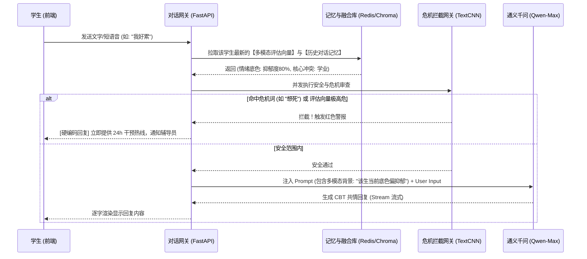

> owner: A ｜ version: 0.1 ｜ status: 定稿 ｜ updated: 2026-10-20

> 归档说明：历史文档完整保留，原路径为 `docs/MODULE_SEPARATION_ANALYSIS.md`。文中指标、标题与实现描述均为历史内容，未经本次核验，不代表当前状态。

# 心域智链 (Health New) - AI心理系统双轨模块拆分与融合方案报告

## 1. 核心问题与重构目标
当前系统中的“多模态AI心理咨询助手”与传统的“AI心理咨询”存在严重的**业务场景重叠**与**交互逻辑冲突**。多模态模块试图在实时对话中强行塞入图片、语音和表情特征的复杂计算，导致前端交互冗余、接口延迟不可控，且违背了心理咨询中“连贯倾听”的原则。

**重构目标**：将二者彻底解耦，走向**“评估与干预双轨制”**：
1. **多模态AI心理评估助手（非对话式）**：作为心理状态的“CT扫描仪”，通过单次收集多模态切片（沙盘画作、一段语音日记、微表情抓拍），输出高维度的心理状态雷达图和诊断参考。
2. **AI心理咨询（对话式）**：作为心理干预的“倾听者”，专注于高流畅度、低延迟的多轮文本/语音对话，并在后台隐式调用多模态助手输出的评估报告作为长程记忆（Context）。

---

## 2. 核心功能对比矩阵与业务边界

| 维度 | 🤖 多模态AI心理评估助手 (Multimodal Assessor) | 💬 AI心理咨询 (Conversational Counselor) |
| :--- | :--- | :--- |
| **业务定位** | **非对话式**的深度心理特征提取与综合状态评估 | **对话式**的持续心理支持、倾听与认知行为疗法(CBT)干预 |
| **用户心智** | 像是在做一个“沉浸式的心理CT检查”或“艺术表达室” | 像是在和一位温暖的学长/学姐进行私密的文字或语音夜聊 |
| **交互频次** | 单次提交，异步生成长篇分析报告（几分钟至十几分钟操作一次） | 高频、连续的你来我往（响应要求毫秒级） |
| **输入模态** | **强多模态**：上传画作/照片、录制一段3分钟日记、录制表情视频 | **弱多模态**：纯文本、实时短语音转文字(ASR) |
| **核心算法** | CNN+CLIP(图像情感)、Wav2Vec(声学特征)、RoBERTa(多模态融合) | Qwen-Max(大语言模型)、RAG(检索增强)、TextCNN(危机短文本拦截) |
| **输出结果** | 5维风险雷达图、色彩心理学解读、注意力热图、长篇评估建议 | 流式的文本回复、拟人语音TTS、短文本情绪气泡 |

---

## 3. 多模态AI心理助手：非对话式交互场景设计

为了解决多模态无法实时聊天的技术限制，我们将交互设计为**“情境任务式（Task-based）”**，剥离对话框，代之以沉浸式工作台。

### 3.1 具体交互场景
* **场景A：沙盘与色彩疗法（视觉主导）**
  * **交互**：提供一个 H5 涂鸦画板或照片上传框，学生凭直觉作画或上传代表今天心情的照片。
  * **分析**：不进行聊天。系统后台调用 CLIP 模型分析色彩饱和度、线条凌乱度、构图特征，直接生成“潜意识色彩报告”（如：大面积冷色调反映了内心的孤独感）。
* **场景B：情绪树洞日记（语音+文本主导）**
  * **交互**：按住麦克风，闭上眼睛倾诉一段不超过3分钟的语音日记（不期待AI马上回话）。
  * **分析**：提取语音的基频、语速、停顿停顿（声学特征）结合 ASR 转写的文本语义，进行跨模态融合计算，输出“情绪压抑度”、“疲惫指数”。
* **场景C：微表情打卡（视频/面部主导）**
  * **交互**：调用前置摄像头进行 10 秒钟的表情捕捉打卡。
  * **分析**：通过 FACS（面部动作编码系统）提取皱眉、嘴角下垂等特征，生成当日微表情健康度。

### 3.2 多模态数据融合方案 (Late Fusion)
由于不同模态的数据维度和采样率不同，采用**决策级融合（Late Fusion）**策略：
1. **单模态独立推理**：图像进 CNN，文本进 BERT，音频进 Wav2Vec。各输出一个 7 维情绪概率向量。
2. **权重动态分配**：如果环境嘈杂（音频信噪比低），则自动降低音频特征权重；如果图片清晰，则提高视觉权重。
3. **加权求和与输出**：将多模态结果进行 Softmax 加权融合，最终落盘为 `Multimodal_State_Vector`，供后续的“AI心理咨询”读取。

---

## 4. AI心理咨询：完整的对话式心理支持流程

该模块回归纯粹的“Chat”体验，注重**连贯性、安全性和低延迟**。

### 4.1 交互流程图 (Mermaid)

---

## 5. 技术实现路径差异

### 5.1 多模态评估助手 (Heavy & Async)
* **架构**：采用**异步任务队列**（如 Celery + RabbitMQ）。用户提交图片/语音后，前端显示“正在深度生成您的专属心境报告，请稍候...”。
* **算力消耗**：高。需要调用多个大模型（VLM 视觉语言模型、声学模型）。
* **接口设计**：`POST /api/multimodal/submit_task` (返回 TaskID) -> `GET /api/multimodal/task_status` (轮询结果)。

### 5.2 AI 心理咨询 (Light & Streaming)
* **架构**：采用 **SSE (Server-Sent Events) 或 WebSocket**，保持长连接。
* **算力消耗**：中等。前置安全网关极轻量（ONNX 部署，耗时 <50ms），大语言模型采用 vLLM 推理引擎保证 TTFT（首首字时间）< 800ms。
* **接口设计**：`POST /api/chat/stream` (流式响应)。

---

## 6. 用户体验优化与用户测试标准

### 6.1 用户体验优化策略
1. **避免恐怖谷效应**：多模态助手的报告中，避免使用冷冰冰的“抑郁症”、“焦虑症”等医疗诊断词汇，转而使用“心灵感冒”、“云层遮蔽了阳光”等隐喻和色彩疗法话术。
2. **多模态结论隐式注入**：学生在“多模态助手”中画了一幅压抑的画，当他随后切入“AI心理咨询”聊天时，AI 会主动破冰：“我看了你刚才的画，感觉你今天似乎背负着很重的壳，愿意和我说说吗？”——**实现模块间的灵魂共振，而非功能堆砌**。

### 6.2 验收与测试标准

| 测试维度 | 多模态AI评估助手 | AI心理咨询对话 |
| :--- | :--- | :--- |
| **性能指标** | 复杂多模态融合报告生成时间 ≤ 15 秒 | 首字响应时间(TTFT) ≤ 800ms，端到端延迟 ≤ 2秒 |
| **并发要求** | 支持 500 QPS (峰值异步排队不丢失) | 支持 5000 在线并发长连接，P99 延迟稳定 |
| **准确率指标** | 5维情绪雷达图与标准心理量表(SDS/SAS)皮尔逊相关系数 r ≥ 0.75 | 危机短文本拦截召回率 ≥ 98%，误报率 ≤ 5% |
| **用户主观评分** | “自我探索的趣味性与深刻感”问卷评分 ≥ 4.5/5 | “AI 的共情度与人机信任感”问卷评分 ≥ 4.6/5 |
| **合规标准** | 敏感图像/语音原文件不落盘，仅存特征向量，符合《个保法》 | 对话记录 AES 加密，触发警报时 30 秒内触达教师端 |
