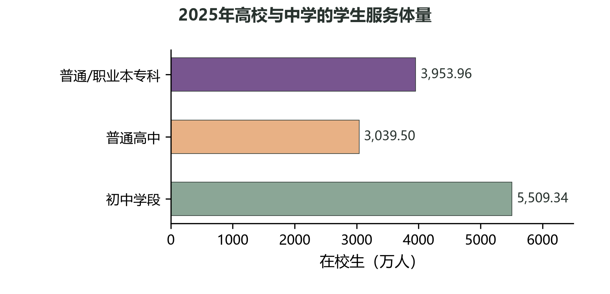
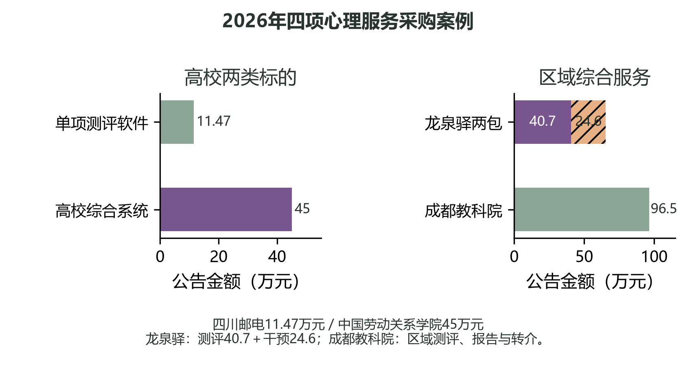

# 第三章 市场分析

> owner: CH03 ｜ version: 1.1 ｜ status: 冻结待Lead统稿 ｜ updated: 2026-10-27

## 3.1 服务场景与市场入口

学校对心理健康支持的组织方式，通常从校内测评、学生求助和咨询预约开始，逐步延伸到教师复核、服务跟进及管理汇总。对项目而言，市场判断应落在学校是否有明确流程、负责人员、可用预算及合适的采购范围，而不是把在校生总量直接换算成客户或收入。

教育部《2025年全国教育事业发展统计公报》列出全国高等学校3167所，普通、职业本专科在校生3953.96万人；普通高中1.61万所、在校生3039.50万人；初中5.16万所、初中阶段在校生5509.34万人。[4]这些数字说明高校和中学均存在可供学校服务的组织场景。高校心理中心、学生工作部门可围绕测评组织、预约、人工复核和个体服务跟进提出需求；中学场景则更多涉及区域统筹、学校实施、学生告知及适龄支持安排。图3-1与表3-1并列呈现不同教育阶段的学校和学生规模，便于识别场景层次。

| 教育场景 | 学校数量 | 在校学生规模 | 可能对应的服务组织场景 |
| --- | ---: | ---: | --- |
| 高等教育 | 高等学校3167所 | 普通、职业本专科3953.96万人 | 高校心理中心、学生工作部门及校内信息化协同 |
| 普通高中 | 1.61万所 | 3039.50万人 | 学校心理教师开展教育支持，教育部门可统筹区域服务 |
| 初中 | 5.16万所 | 5509.34万人 | 区县或学校组织适龄支持，并明确校内专业承接 |

## 3.2 地区差异与优先进入顺序

教育资源分布、学校采购组织和服务供给能力因地区而异。比较各省份时，应将高校、中学分别观察，并结合学校数量、学生规模、教育行政层级和可获取的采购信息；单一总量无法说明实际采购机会。地区数据的统计年份和教育口径应保持一致，不能把省级教育规模直接解释为心理服务需求或可实现收入。

{{REGIONAL_COMPARISON}}

高校是项目优先进入和验证的场景。高校决策链通常包括业务部门提出需求、心理专业人员确认服务流程、信息化与安全部门审查、采购及财务部门按校内程序决策。项目可从测评后记录整理、预约衔接、教师人工复核和跟进留痕等具体任务切入；先讨论小范围流程验证，再依据校方要求确定部署和服务范围。当前没有可写入申报书的获批试点、正式客户、收入或专业效果承诺，故市场进入仍应表述为拟验证方向。

初中和普通高中是后续的年龄适配方向，而非高校方案的直接复制。进入中学前，还需由学校及专业人员明确工具适用年龄、学生告知和参与安排、适用的监护流程、教师权限、信息留存及异常线索的人工处理责任。区域项目还需约定覆盖范围、服务人数口径、专业服务边界和验收内容。上述条件会影响产品形态和采购主体，应在高校路径形成经验后再单独论证。

## 3.3 采购案例与产品切入

公开采购公告呈现了不同采购对象和交付组合：四川邮电职业技术学院以11.47万元采购心理健康测评系统应用软件1套；中国劳动关系学院成交金额45万元，范围包括学生访谈测评、职工场景适配、陪伴、培训、管理平台、干预练习及部署；成都市龙泉驿区教育局测评与筛查后干预两包合计65.3万元，其中测评40.7万元、干预24.6万元，公告所列测评对象约8.5万人，另含不少于1600人访谈及不少于300人个体咨询；成都市教育科学研究院项目成交96.5万元，面向不少于20万名抽样学生测评并含分层报告和转介通道。[5]—[8]表3-2和图3-2把金额与采购内容并置，反映市场上既有单项软件，也有组合式区域服务。

| 学校或地区 | 采购内容 | 服务对象 | 成交金额 |
| --- | --- | --- | ---: |
| 四川邮电职业技术学院 | 心理健康测评系统应用软件1套 | 校内使用 | 11.47万元 |
| 中国劳动关系学院 | 访谈测评、职工场景适配、陪伴、培训、平台、干预练习及部署 | 学生及职工场景 | 45万元 |
| 成都市龙泉驿区教育局 | 测评40.7万元；筛查后干预24.6万元，含档案、培训、访谈和咨询 | 约8.5万人测评；不少于1600人访谈、不少于300人个体咨询 | 合计65.3万元 |
| 成都市教育科学研究院 | 抽样测评、分层报告及转介通道 | 不少于20万名抽样学生 | 96.5万元 |

案例为产品设计提供的是采购范围参照，而非可直接照搬的定价。项目当前适合围绕高校既有服务流程提出软件原型和可配置工作流，待学校确认需求后再明确部署、运维及专业服务是否纳入采购。产品切入应回应具体任务：让学生能够提出求助或预约，让教师在授权范围内查看并处理记录，让学校按明确权限汇总服务过程。后续再以学校书面确认的试点目标、采购要求和评审意见决定是否扩展；不据公开案例推算单校客单价或总体市场金额。

### 供Lead移入附录的说明

教育部高校总数包含成人高校，3953.96万人仅为普通、职业本专科在校生，统计范围不完全重合；高中、初中学校数及学生数按对应学段统计，包含一贯制、完全中学等相关学段。教育统计不代表心理服务需求、采购客户数、测评覆盖率或收入。四项采购均为公告成交金额，成交不等于合同履约验收、持续使用或服务效果；采购对象、服务内容、对象规模及期限不同，不得计算同质均价、每生价格、市场收入或渗透率。来源及详细范围分别见[4]—[8]。
