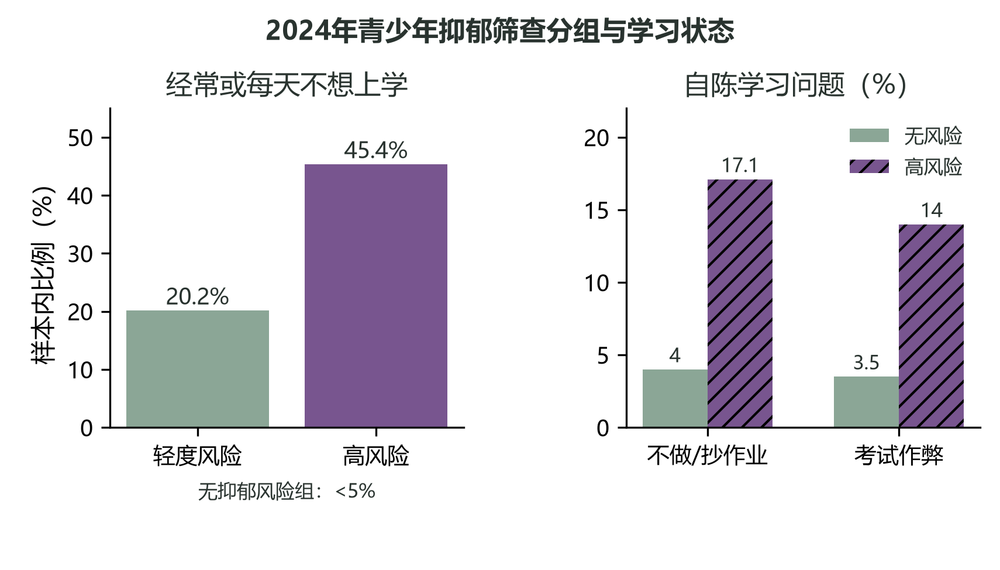
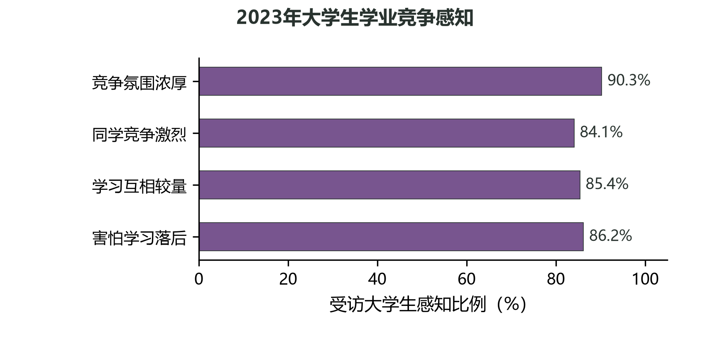
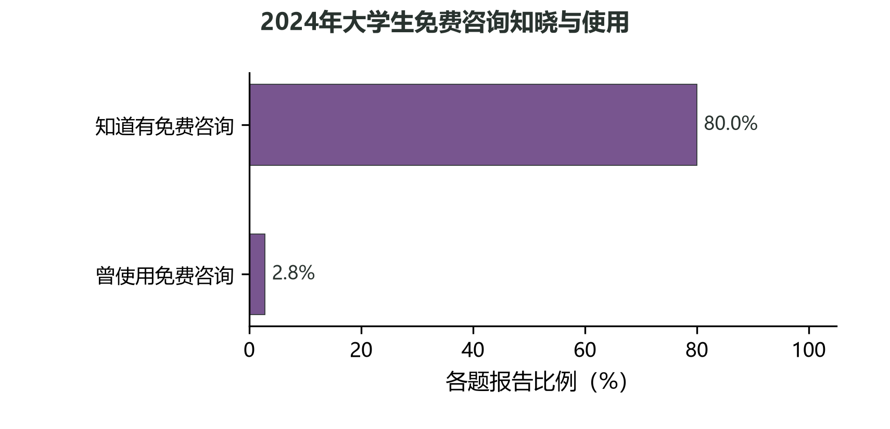
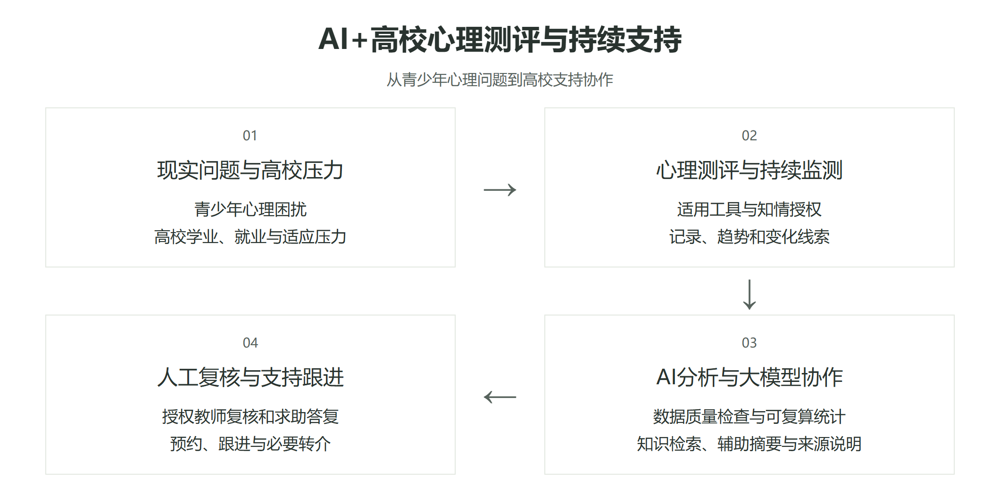
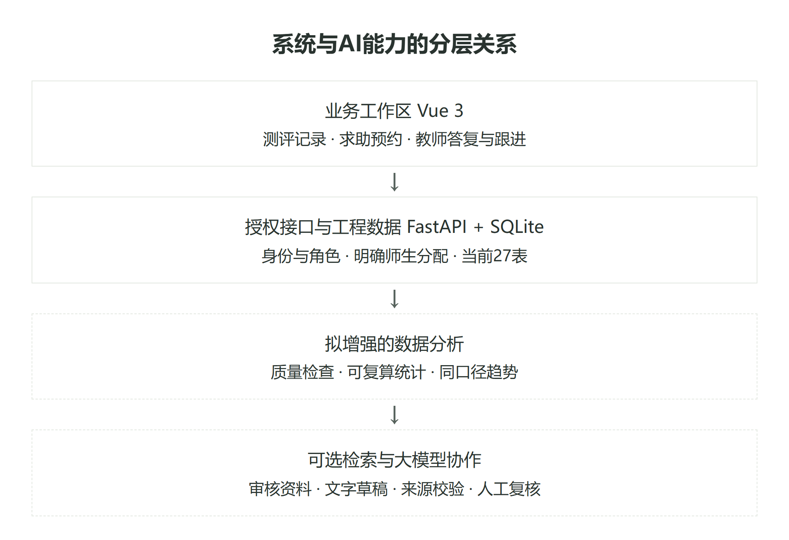
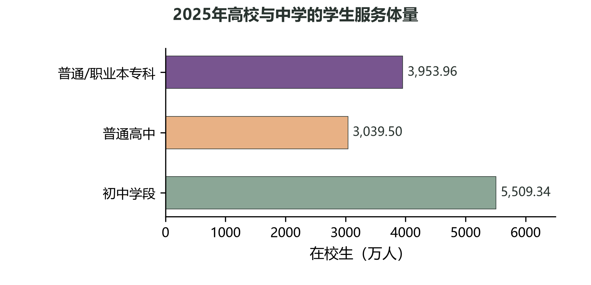
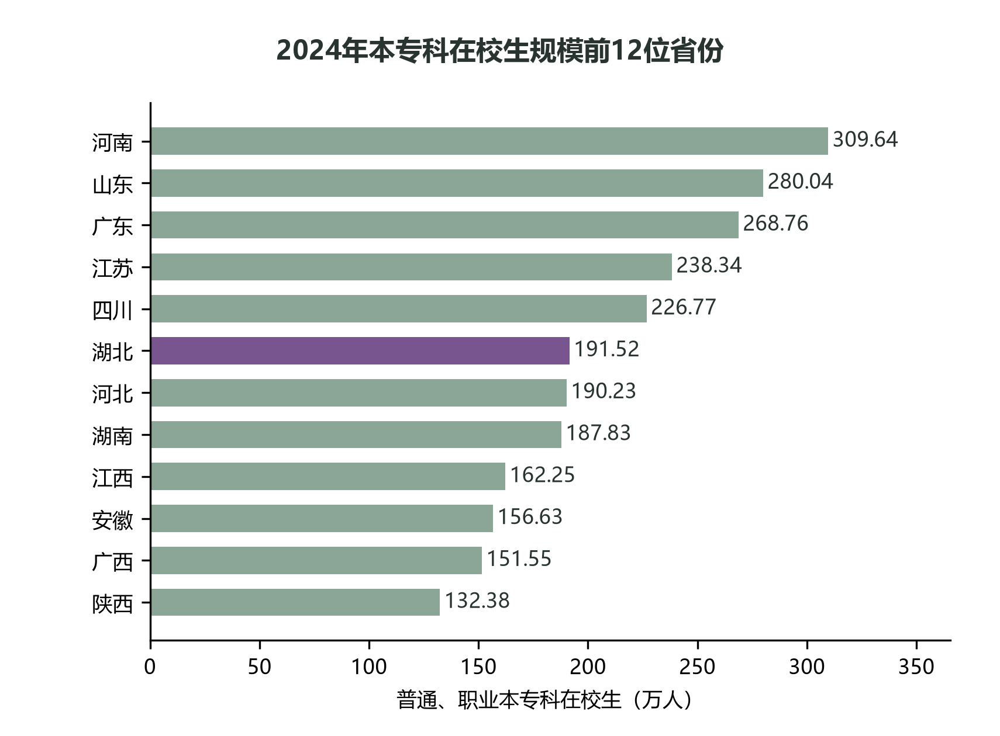
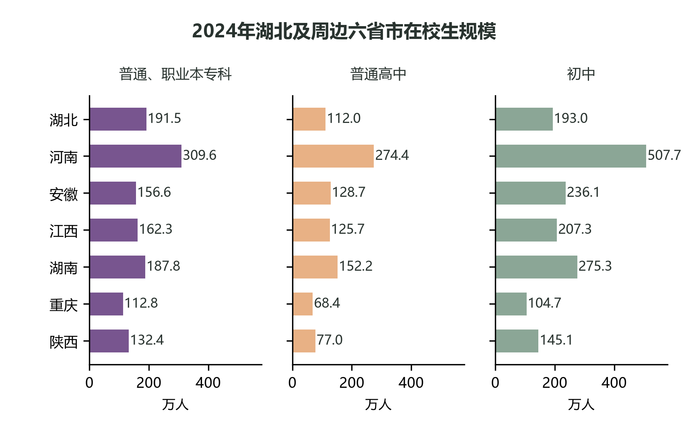
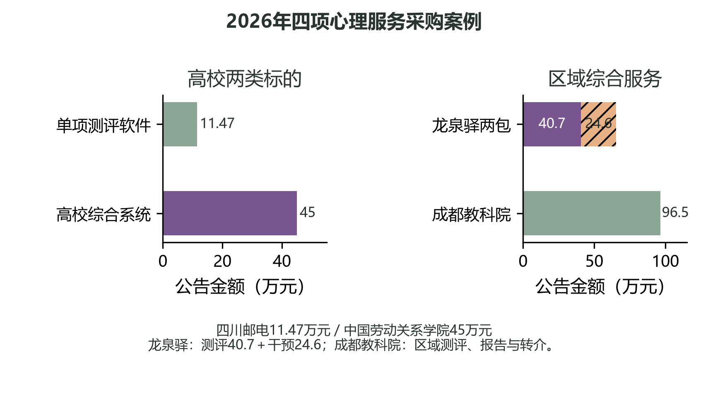
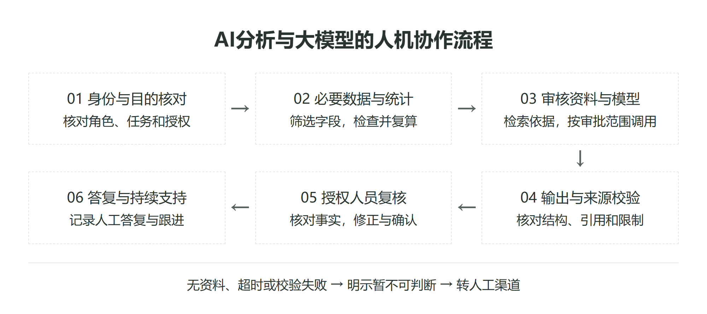

# 心域智链AI+校园心理支持协作平台项目申报书

> owner: A ｜ version: 3.0 ｜ status: 文风与地区数据修订审阅稿 ｜ updated: 2026-10-27

## 摘要

心域智链面向高校学生心理测评与后续支持。学生在一次测评之后，还需要看懂记录、找到求助入口；教师则需要在答复和后续沟通中查阅相关资料。项目拟将测评、记录查看、求助预约和教师跟进放在同一平台，在已有前后端基础上完善数据整理和使用流程。AI主要承担资料检索与摘要起草，把记录中的事实、缺失信息和待核对问题分开呈现，由教师核查后使用。项目比较了31个省份的高校和中学在校生规模，并整理地方心理服务建设资料及公开采购案例，以此安排湖北高校的前期调研和产品验证。后续再根据不同学段的工作方式调整初高中版本。预期成果包括软件原型、数据图表、摘要与评测记录，以及培训和运行维护材料。

## 1 实用性与创新力

### 1.1 压力沿着成长阶段变化

青少年在校期间，学习困难往往不只表现为成绩起伏。考试、升学期待和同伴关系交织时，学生可能逐渐回避课堂与作业，也可能把困扰藏起来。2024年青少年心理健康与学业状况调查覆盖小学四年级至高中三年级五万余名学生。报告显示，在抑郁筛查高风险组中，45.4%自陈经常或每天有“不想上学”的想法；无抑郁风险组相同回答比例低于5%。这一差异提示，学习状态值得和情绪线索放在一起理解。[1]

图1 2024年青少年抑郁筛查分组与学习状态

进入高校后，任务变得更自主，也更分散。学生需要适应专业课程、离家生活和新的关系网络，同时面对升学与就业选择。基于2023年“中国大学生追踪调查”的研究中，90.3%的受访者认为所处环境竞争氛围浓厚，84.1%感到同学之间竞争激烈；另有85.4%认同学习上存在相互较量，86.2%表示害怕学习落后。这些指标描述的是学生对竞争环境的感知，呈现出高校学业适应中的现实压力。[2]

图2 2023年大学生学业竞争感知

高校提供咨询服务，也需要知道学生是否了解入口、是否愿意使用。2024年一项面向本科生的调查取得60,782份有效问卷。报告中的两道题分别显示，80.0%的受访者知道学校提供免费心理咨询，2.8%表示曾使用该服务。[3] 对学校而言，这组结果提出了一个具体问题：有服务并不必然意味着学生能找到适合自己的支持。除了咨询，还需要容易理解的自我了解工具、清晰的求助路径，以及在学生愿意参与时由教师或专业人员提供的后续沟通。

图3 2024年大学生免费咨询知晓与使用

表1 学生心理与服务调查

| 调查 | 对象 | 指标 | 结果 |
| --- | --- | --- | --- |
| 2024年青少年心理健康与学业状况调查 [1] | 小学四年级至高中三年级学生，五万余人 | 抑郁筛查高风险组经常或每天不想上学；无风险组同项 | 45.4%；<5% |
| 2023年中国大学生追踪调查 [2] | 论文所用大学生样本 | 认为竞争氛围浓厚；感到同学竞争激烈；认同学习相互较量；害怕学习落后 | 90.3%；84.1%；85.4%；86.2% |
| 2024年大学生心理健康状况调查 [3] | 本科生，有效问卷60,782份 | 知道学校提供免费心理咨询；曾使用该服务 | 80.0%；2.8% |

### 1.2 让测评成为沟通的起点

测评的价值在于提供一组可讨论的线索，而非替学生下结论。统一题项有助于学生梳理近期感受，也能帮助学校了解群体中常见的困扰主题。若学生同意参与，阶段性记录还可以支持双方回看变化：最近何时感到压力、哪些学习或生活情境同时发生、自己希望得到什么帮助。记录本身不能说明原因，关键仍是学生如何描述经历，以及工作人员如何结合现实情况倾听和回应。

本项目面向学生提供测评、个人报告与求助入口，并让教师或咨询人员在履职范围内查看经允许的信息。教师看到线索后，可以发起适当沟通；需要进一步支持时，再由具备相应职责的人员接续。学生可以了解测评用途、数据可见范围和反馈方式。只有与服务目的直接相关的信息才应进入处理流程，权限也应按角色和具体职责设置。这样的设计把“发现困扰”连接到“有人回应”，避免测评只留下一个分数或一份无人阅读的报告。

### 1.3 AI协助整理，专业人员负责回应

项目拟用统计代码整理测评时间、已确认分数、缺失字段和可比较的变化，结果以图表呈现。大模型接收这些已核对的结构化事实和审核过的参考资料，起草供工作人员复核的短摘要，列出记录要点、资料出处和待确认事项。工作人员对照记录修改草稿，再用于沟通准备。

例如，同一量表和版本的阶段记录可以并列展示；摘要同时列出所用时间范围、已有信息和资料缺口。工作人员先核对记录，再听取学生对实际经历的说明。资料不足时，摘要保留待确认项，由双方沟通补足背景。学生与工作人员的实际交流，是后续支持的主要依据。

项目的创新点，是把学生自我了解、教师沟通和咨询服务放进同一条可理解的使用路径，并让数据呈现服务于具体的支持行动。学生端关注反馈是否清楚、求助是否方便；教师端关注如何识别需要沟通的线索；学校层面的汇总则可为心理教育内容与服务资源安排提供参考。

图4 AI+高校心理测评与持续支持逻辑图

## 2 产品与服务

### 2.1 产品面向的日常任务

“心域智链”是服务高校心理健康教育的软件原型。它围绕学生完成测评、查看自己的记录、提出求助，以及教师处理分配给自己的学生事项来组织功能。学生能在同一入口查看记录并找到后续支持方式；教师能依据已有资料回应具体问题；学校可据此判断后续建设方向。

产品中的AI用于整理信息。它可以把已确认的测评字段、记录时间和经过审核的资料归纳成易读摘要，帮助教师更快看清已有信息、资料缺口和可用支持入口。生成内容应显示为待复核草稿，由教师对照原始记录和资料后决定是否采用。

### 2.2 学生与教师如何使用

学生按提示逐题作答并提交。结果页呈现相应记录；仪表盘和报告页可供学生查看个人趋势或报告信息。记录的价值在于帮助学生回看一段时间内的变化，结果解释仍应结合量表说明和实际交流。若学生希望进一步沟通，可提交求助或预约。学生之后可在求助页面查看当前答复状态和教师回复；若尚未分配处理人员，页面会明确显示等待状态。

教师进入工作页面后，查看的是系统中明确分配给自己的学生及其相关事项。教师不能仅凭学生自填的导师姓名扩大访问范围。收到求助后，教师可阅读学生提交的内容，撰写答复；需要后续联系时，可建立跟进事项并更新处理情况。教师作出的判断和答复由教师本人负责，系统提供的是资料查看与工作记录工具。

表2 学生与教师的主要使用任务

| 使用者 | 当前任务 | 系统提供的支持 |
| --- | --- | --- |
| 学生 | 完成测评、查看个人记录与趋势 | 作答、结果、图表和报告页面 |
| 学生 | 提出问题或预约，查看答复 | 求助入口、状态与回复展示 |
| 教师 | 查看分配学生的相关记录 | 按角色和明确分配关系筛选资料 |
| 教师 | 回应求助并继续跟进 | 答复、跟进事项及处理状态 |
| 学校 | 评估流程是否适合本校使用 | 后续建设可补充流程配置与汇总视图 |

图5 系统与AI能力的分层关系

### 2.3 AI整理信息的方式

AI能力适合放在已有记录与人工服务之间，承担有限的信息整理工作。以测评记录为例，系统先按已确认的规则形成分数和结构化字段，再检查资料是否完整。AI可依据这些已确认事实及审核过的资料，起草一段说明，清楚区分记录本身、资料中的一般信息和仍待确认的问题。教师核对后，可修改或舍弃草稿，再决定如何向学生解释。

在求助场景中，学生原始表述是教师理解问题的依据。若后续建设摘要功能，可将必要内容整理成简短提要，并列出需要教师确认的事项。没有可靠依据、必要字段缺失或生成结果不完整时，应返回现有记录和人工处理入口，不用推测补齐事实。

这类AI的价值在于减少重复查找和摘录，让摘要保留事实来源、让学生更容易读懂记录。

### 2.4 现有功能与下一步建设

现有功能：工程中已有测评作答与结果页面、学生个人趋势和报告、求助入口，以及教师侧的分配学生访问、答复和跟进流程。后端还包含本地规则分析、结构化报告和个人报告读取等实现。以上构成可供继续开发的技术原型。

下一步建设：先确认学校采用的量表、求助和预约流程、数据字段及复核责任；再建设AI摘要任务，将审核资料、必要字段、生成草稿、依据展示和人工修改安排在清晰的界面与接口中。外部模型如需启用，应先确定提供方、版本、数据处理方式及审批要求，并评估生成内容的准确性、遗漏、越界、失败处理和成本。学生与教师流程应继续保持可用，使AI关闭或不可用时，教师仍能按现有方式查看记录、答复和跟进。

表3 产品建设安排

| 阶段 | 建设内容 | 形成的交付 |
| --- | --- | --- |
| 流程确认 | 核对量表、求助、预约与校内责任 | 经学校确认的流程和字段清单 |
| 辅助摘要 | 基于审核资料和已确认字段生成草稿 | 可供教师核对、修改或弃用的摘要 |
| 隔离评估 | 检查事实一致性、遗漏、越界与故障退回 | 评估记录及需修订事项 |
| 小范围试用 | 经校内批准后观察任务用时与使用反馈 | 是否继续建设的依据 |

### 2.5 服务对象与实施方式

项目首先面向高校心理健康教育与支持流程，围绕测评记录查看、求助处理和后续跟进开展验证。实施前由学校确定使用范围、职责、资料来源、保存方式及求助承接流程。

中学场景需另行评估适龄量表、未成年人信息保护及专业承接流程。后续可提供流程梳理、配置、培训和复盘，部署由学校决定。

## 3 市场分析

### 3.1 服务场景与市场入口

学校对心理健康支持的组织方式，通常从校内测评、学生求助和咨询预约开始，逐步延伸到教师复核、服务跟进及管理汇总。对项目而言，市场判断应落在学校是否有明确流程、负责人员、可用预算及合适的采购范围。

教育部《2025年全国教育事业发展统计公报》列出全国高等学校3167所，普通、职业本专科在校生3953.96万人；普通高中1.61万所、在校生3039.50万人；初中5.16万所、初中阶段在校生5509.34万人。[4]这些数字说明高校和中学均存在可供学校服务的组织场景。高校心理中心、学生工作部门可围绕测评组织、预约、人工复核和个体服务跟进提出需求；中学场景则更多涉及区域统筹、学校实施、学生告知及适龄支持安排。

表4 2025年高校与初高中教育规模

| 教育场景 | 学校数量 | 在校学生规模 | 可能对应的服务组织场景 |
| --- | --- | --- | --- |
| 高等教育 | 高等学校3167所 | 普通、职业本专科3953.96万人 | 高校心理中心、学生工作部门及校内信息化协同 |
| 普通高中 | 1.61万所 | 3039.50万人 | 学校心理教师开展教育支持，教育部门可统筹区域服务 |
| 初中 | 5.16万所 | 5509.34万人 | 区县或学校组织适龄支持，并明确校内专业承接 |

图6 2025年高校与中学的学生服务体量

学校心理服务的建设也在推进。教育部2025年通报，首次全国学生心理健康监测覆盖150万名学生[9]。2023—2025年专项行动和2026年健康学校建设意见将测评、咨询与服务网络列入学校工作[10][11]。对本项目来说，测评信息需要便于查看和整理，后续沟通也要能连接教师与咨询服务。

### 3.2 地区差异与优先进入顺序

教育部2024年地区统计列出了31个省份的高校和中学生规模，表中同时给出普通、职业高校数量。

表5 2024年31省份高校与中学教育规模 [12]—[16]

| 地区 | 普通、职业高校（所） | 本专科在校生（万人） | 普通高中在校生（万人） | 初中在校生（万人） |
| --- | --- | --- | --- | --- |
| 北京 | 92 | 66.54 | 23.63 | 41.14 |
| 天津 | 56 | 60.54 | 24.02 | 41.83 |
| 河北 | 129 | 190.23 | 190.56 | 343.46 |
| 山西 | 83 | 96.75 | 69.82 | 114.38 |
| 内蒙古 | 54 | 55.27 | 43.74 | 67.71 |
| 辽宁 | 114 | 118.72 | 62.91 | 95.34 |
| 吉林 | 67 | 83.71 | 43.41 | 58.95 |
| 黑龙江 | 78 | 94.90 | 53.12 | 76.91 |
| 上海 | 69 | 58.73 | 22.42 | 61.53 |
| 江苏 | 172 | 238.34 | 153.21 | 287.86 |
| 浙江 | 109 | 131.81 | 92.70 | 182.82 |
| 安徽 | 125 | 156.63 | 128.66 | 236.12 |
| 福建 | 88 | 116.89 | 88.86 | 165.42 |
| 江西 | 111 | 162.25 | 125.67 | 207.29 |
| 山东 | 161 | 280.04 | 208.31 | 405.50 |
| 河南 | 174 | 309.64 | 274.37 | 507.73 |
| 湖北 | 133 | 191.52 | 111.97 | 193.03 |
| 湖南 | 140 | 187.83 | 152.22 | 275.30 |
| 广东 | 165 | 268.76 | 235.46 | 503.30 |
| 广西 | 89 | 151.55 | 131.72 | 254.38 |
| 海南 | 26 | 28.76 | 22.83 | 43.33 |
| 重庆 | 73 | 112.79 | 68.40 | 104.71 |
| 四川 | 139 | 226.77 | 152.68 | 277.16 |
| 贵州 | 80 | 91.12 | 96.88 | 202.31 |
| 云南 | 91 | 114.96 | 106.06 | 191.82 |
| 西藏 | 7 | 4.39 | 7.94 | 16.53 |
| 陕西 | 97 | 132.38 | 77.04 | 145.15 |
| 甘肃 | 50 | 66.82 | 58.30 | 98.56 |
| 青海 | 13 | 8.66 | 13.47 | 25.15 |
| 宁夏 | 22 | 18.34 | 18.08 | 29.65 |
| 新疆 | 63 | 65.63 | 63.83 | 131.78 |

从本专科在校生规模看，河南、山东、广东居前，分别为309.64万人、280.04万人、268.76万人。图7列出规模前12位的省份，便于比较高校学生群体的分布。

图7 2024年本专科在校生规模前12位省份

湖北有普通、职业高校133所，本专科在校生191.52万人，位列第6，占31省份合计的4.92%。普通高中和初中在校生分别为111.97万人、193.03万人。项目拟先围绕湖北高校的测评记录、教师答复和后续沟通开展调研，再与周边省市的学校交流使用流程。

图8 2024年湖北及周边六省市在校生规模

地方学校心理服务建设已有多种做法。武汉报道了心理教师配备情况，广东的项目资金用于心理辅导室建设，嘉兴市南湖区则为新入学随迁子女安排专题活动。其他地区通过指南和标准明确学校应提供哪些服务。

表6 8个地区学校心理服务建设的公开进展与要求

| 地区 | 发布或报告年份 | 工作内容 | 已报进展或文件要求 |
| --- | --- | --- | --- |
| 湖北省武汉市 | 2026年报道 | 中小学专兼职心理教师 | 报道配备率超过95% [17] |
| 广东省项目学校 | 2024 | 义务教育心理辅导室建设 | 项目报告完成64所 [18] |
| 江苏省 | 2024 | 中小学心理辅导室建设 | 发布省级建设与管理指南 [19] |
| 浙江省嘉兴市南湖区 | 2024 | 新入学随迁子女心理辅导 | 报道开展20场专题活动 [20] |
| 山东省 | 2024 | 初中心理咨询室装备 | 指南列明空间、设备与在线系统要求 [21] |
| 四川省 | 2026 | 中小学心理辅导室建设 | 地方标准于6月29日实施 [22] |
| 河南省郑州市 | 2024 | 义务教育心理支持服务 | 发布服务规范，规定11月16日起实施 [23] |
| 北京市 | 2024发布 | 中小学心理教师配备 | 行动计划要求每校至少1名专职教师 [24] |

高校是项目优先进入和验证的场景。高校决策链通常包括业务部门提出需求、心理专业人员确认服务流程、信息化与安全部门审查、采购及财务部门按校内程序决策。项目可从测评后记录整理、预约衔接、教师人工复核和跟进留痕等具体任务切入；先讨论小范围流程验证，再依据校方要求确定部署和服务范围。

初中和普通高中是后续的年龄适配方向，而非高校方案的直接复制。进入中学前，还需由学校及专业人员明确工具适用年龄、学生告知和参与安排、适用的监护流程、教师权限、信息留存及异常线索的人工处理责任。区域项目还需约定覆盖范围、服务人数口径、专业服务边界和验收内容。上述条件会影响产品形态和采购主体，应在高校路径形成经验后再单独论证。

### 3.3 采购案例与产品切入

公开采购公告呈现了不同采购对象和交付组合：四川邮电职业技术学院以11.47万元采购心理健康测评系统应用软件1套；中国劳动关系学院成交金额45万元，范围包括学生访谈测评、职工场景适配、陪伴、培训、管理平台、干预练习及部署；成都市龙泉驿区教育局测评与筛查后干预两包合计65.3万元，其中测评40.7万元、干预24.6万元，公告所列测评对象约8.5万人，另含不少于1600人访谈及不少于300人个体咨询；成都市教育科学研究院项目成交96.5万元，面向不少于20万名抽样学生测评并含分层报告和转介通道。[5]—[8]

表7 四项学校心理服务采购案例

| 学校或地区 | 采购内容 | 服务对象 | 成交金额 |
| --- | --- | --- | --- |
| 四川邮电职业技术学院 | 心理健康测评系统应用软件1套 | 校内使用 | 11.47万元 |
| 中国劳动关系学院 | 访谈测评、职工场景适配、陪伴、培训、平台、干预练习及部署 | 学生及职工场景 | 45万元 |
| 成都市龙泉驿区教育局 | 测评40.7万元；筛查后干预24.6万元，含档案、培训、访谈和咨询 | 约8.5万人测评；不少于1600人访谈、不少于300人个体咨询 | 合计65.3万元 |
| 成都市教育科学研究院 | 抽样测评、分层报告及转介通道 | 不少于20万名抽样学生 | 96.5万元 |

图9 2026年四项心理服务采购案例

案例为产品设计提供的是采购范围参照，而非可直接照搬的定价。项目当前适合围绕高校既有服务流程提出软件原型和可配置工作流，待学校确认需求后再明确部署、运维及专业服务是否纳入采购。产品切入应回应具体任务：让学生能够提出求助或预约，让教师在授权范围内查看并处理记录，让学校按明确权限汇总服务过程。

## 4 推广与实施

### 4.1 从高校实际流程开始

项目拟先在湖北高校了解心理健康服务的日常流程，再据此调整产品和服务内容。沟通重点放在测评完成后，学生怎样读懂结果、怎样找到求助入口，教师怎样查看分配给自己的事项、作出答复并安排后续联系，以及学校如何维护量表、人员权限和服务资料。团队计划与校内心理服务和学生工作人员交流，并向信息化、管理及采购相关人员了解系统接入、维护和校内办理步骤。若学校安排学生代表参与需求讨论，将以自愿、易懂的方式征求其对页面说明和使用步骤的意见。

交流后，团队将把需求整理为具体任务，例如学生完成一项测评并找到结果说明、提出求助、教师打开待处理事项并回复、负责人查看服务流程记录。每项任务都对应实际使用角色、所需信息和可能遇到的困难。校内人员可据此指出哪些步骤符合现行做法，哪些需要由学校另行确认。

### 4.2 原型演示与服务安排

需求初步明确后，团队拟先使用合成案例演示学生端和教师端的主要流程。学生端展示测评说明、结果查看、求助入口及答复状态；教师端展示分配事项、记录查阅、人工答复和后续跟进。演示重点是任务能否按顺序完成、页面提示是否清楚、教师是否容易找到必要信息。AI生成内容如纳入演示，将作为供教师阅读和修改的草稿，展示相关依据和人工复核位置，不代替教师答复。

服务可围绕流程梳理、系统配置、人员培训和运行维护逐步开展。团队拟先为校方经办人员和教师准备简明操作材料，通过场景演练讲解账号权限、事项查看、答复记录、常见问题处理及故障反馈；再根据演示意见修改说明和操作步骤。后续如进入校内办理或采购讨论，可按学校要求提供功能范围、部署方式、培训内容、维护响应和费用构成等材料，由学校依其既有程序确定办理路径。项目团队负责产品说明、技术配置和问题修订，校内业务人员负责安排实际服务流程。

表8 推广与实施安排

| 阶段 | 主要工作 | 形成材料 |
| --- | --- | --- |
| 流程了解 | 交流学生求助、教师答复和校内系统办理方式 | 任务清单与待确认事项 |
| 原型演示 | 用合成案例走查学生和教师操作 | 演示记录、问题与修改清单 |
| 培训维护 | 编制操作说明、开展场景练习并收集故障反馈 | 培训材料、维护与响应安排 |
| 任务验证 | 观察步骤完成情况、耗时及教师修改意见 | 任务结果与下一步改进建议 |

### 4.3 观察任务是否顺畅

如果学校后续同意开展小范围验证，团队拟先与校方共同选定少量、边界清楚的任务及观察方式，再由学校安排参与人员和具体时间。观察聚焦使用过程：学生能否找到说明并完成指定步骤，教师能否定位事项、理解记录并提交答复，培训后常见操作是否仍需反复协助。团队可记录任务是否完成、所用时间、发生错误或求助的环节，以及教师对AI草稿的修改次数和修改原因。学生与教师的意见可通过简短反馈收集，作为界面文字、操作顺序和培训材料的修订依据。

评价结果按任务类别整理，既呈现顺利完成的部分，也说明中断、跳过和需要工作人员帮助的情况。团队与校方据此判断下一步是继续调整原型、补充培训，还是先完善流程和维护安排。服务采购和后续扩展可在任务范围、技术条件与费用构成逐步清楚后讨论；是否采用由学校按自身工作安排决定。

### 4.4 后续场景拓展

高校流程经过多轮讨论和任务验证后，团队再考虑初中、高中等场景。届时需分别了解学校实际工作流程，听取相关专业人员意见，调整说明文字、操作角色和服务安排，再决定是否开展针对性的原型验证。

## 5 方案实现

### 5.1 从记录到可读摘要

项目已有Vue前端、FastAPI服务和SQLite数据存储，测评提交、对话记录、报告查看及教师端个体材料等入口已经形成。下一步将把已有记录整理成教师能核对、学生能理解的材料：先确认数据说了什么，再用检索和生成帮助组织文字，最后由教师结合实际情况决定是否答复或跟进。

一条记录进入分析前，系统应检查来源、时间、字段是否齐全、取值是否在允许范围，以及记录间能否比较。例如量表名称或版本不同，就分开呈现；缺少某次记录时明确显示缺失，不用估算值补齐。教师查看个人材料时，可以看到所选时间范围、纳入记录数和未纳入原因。面向群体的图表则先说明统计口径和样本数，避免把记录条数误当成独立人数。现有基础统计可展示分布和一段时间内的变化；只有数据口径相同、时间点足够时，才适合谈趋势。

### 5.2 规则、检索与大模型各做什么

分析分成三步。第一步由规则和统计代码整理字段、计数、时间序列及变化值。这些结果应能从对应记录复算，图表旁标出数据期间、记录数和缺失情况。第二步由知识检索从经确认的校内资料或服务说明中寻找相关段落，提供给摘要起草任务。找不到合适资料时，应说明依据不足，不让模型自行补出制度、联系方式或服务承诺。第三步才由大模型把已确认事实和检索材料写成短摘要草稿；摘要应把“记录显示”“尚缺信息”和“需要教师核对的问题”分开，附上所用时间范围及资料出处。

摘要拟采用以下结构：

表9 AI摘要的拟定结构

| 摘要部分 | 展示内容 |
| --- | --- |
| 已有记录 | 选定期间内的测评或留言记录及其时间；数值只按同版本、同口径比较 |
| 尚缺信息 | 未填写字段、缺少的时间点或无法比较的版本 |
| 待核对问题 | 对记录含义仍不确定之处，以及建议教师向学生确认的事实 |
| 参考依据 | 使用的校内说明或服务资料名称、版本及对应段落 |

图10 AI分析与大模型调用的人机协作流程

教师端应同时显示原始记录入口与摘要草稿，允许教师逐项核对、更正或弃用；只有经人工确认的文字才进入后续沟通。AI负责把材料整理得更容易读，教师负责理解语境、选择是否联系学生以及如何回应。学生可以通过现有求助入口发起沟通；收到的答复由教师核实后发送，不能由模型自动发送或触发处置。

### 5.3 生成不可用时仍能继续服务

模型或检索不可用不应遮住已保存的测评、留言和求助记录。页面应把状态说清楚，例如“摘要暂不可生成”，同时保留记录查看、补充信息和发起求助的入口。教师仍可直接查看原始材料并人工答复；系统不得把本地规则结果伪装成大模型生成内容。这样，生成能力是整理材料的一种辅助方式，而不是学生获得人工支持的前置条件。

现有基础与后续建设分开说明：

表10 现有工程与后续建设

| 已有工程基础 | 拟建设与验证 |
| --- | --- |
| Vue、FastAPI、SQLite；测评、对话、报告及教师材料页面；局部统计、可选RAG与模型接口 | 统一字段质量检查和比较口径；摘要分栏展示事实、缺失与问题；教师核对后使用；完善生成失败时的记录与求助体验 |

后续应先用合成记录检查缺失、版本不一致、无检索结果、超时和人工更正等情形，再由业务及专业人员确认摘要字段和资料范围。只有在数据使用、模型服务及评审安排获批后，才开展隔离评测。

## 6 项目预算与预期成果

### 6.1 团队分工

项目由研发、数据治理、专业审阅、校内业务和运行维护等角色协作完成。研发团队在现有工程基础上完善原型、权限流程、图表分析、隔离测试和操作文档，并对每项结果保留可复查记录。数据治理人员由校方指定，负责明确数据字段、用途、访问范围、留存删除和事件处理要求。心理及相关专业人员审阅测评工具的适用范围、结果说明、案例和人工承接方式；校内业务负责人确认服务流程、角色职责和求助转介安排。信息化与安全人员检查部署、身份权限、日志和备份恢复，运维人员依确认的职责处理监控、故障和恢复演练。

### 6.2 预算测算

预算按实际用量和经核实的单价测算。

表11 项目预算科目

| 预算科目 | 测算方式 | 金额 |
| --- | --- | --- |
| 算力与API | 按经确认的实例时长、调用量及并发需求，结合有效报价核算 | 【后期手动填写】 |
| 部署、存储与备份 | 按批准的实例、使用周期、存储流量及备份恢复用量核算 | 【后期手动填写】 |
| 工具授权与专业评审 | 按所需授权材料数量、评审场次和学校核准标准核算 | 【后期手动填写】 |
| 数据质量与AI评测 | 按数据整理工作量、案例数量、评审轮次及必要资源核算 | 【后期手动填写】 |
| 测试与运维 | 按测试和恢复演练次数、维护工时及监控资源核算 | 【后期手动填写】 |
| 培训与材料 | 按培训场次、参训范围及材料制作数量核算 | 【后期手动填写】 |
| 合计 | 各项核准金额汇总，按申报模板复核 | 【后期手动填写】 |

服务器、场地或人员投入如作为配套资源，应由提供方确认并留存依据。

### 6.3 成果与检查方法

项目计划形成一套可复查的工程原型，包括权限矩阵、数据统计与图表、经后续确认后开展的AI辅助分析、评测记录，以及操作、数据治理和恢复文档。工作以现有工程为基础，新增能力按阶段完成；合成案例用于演示和评测。

各阶段保存软件和案例版本、检查结果与待处理问题。功能检查主要看权限、答复、跟进和导出能否完成；AI摘要另检查事实、遗漏和教师修改情况。

### 6.4 阶段任务与交付

表12 阶段任务与交付

| 任务 | 交付 | 检查方式 |
| --- | --- | --- |
| 梳理责任、数据与工具 | 角色分工、字段用途说明、工具清单和人工承接流程 | 由对应业务、数据和专业人员逐项确认，记录需补充内容 |
| 完成隔离原型 | 合成数据演示、权限与业务流程、问题清单及恢复记录 | 在独立环境复验主要操作、异常处理和恢复过程，并保存测试结果 |
| 整理评测材料 | 案例版本、统计与摘要草稿、人工复核记录、评测结果 | 对照固定案例核查输出和失败分类，复核分母、版本及意见记录 |
| 准备试用与运行材料 | 经确认的操作说明、任务观察记录、运维与交接文档 | 按实际批准的环境和流程检查任务、人工承接、问题处理和退出方式 |
| 完成部署与持续维护准备 | 部署配置、监控及备份恢复材料、维护安排 | 在目标环境检查安全配置、异机恢复和运维责任，形成问题及处理记录 |

## 附录A 数据与图表口径

图示说明：项目方案示意，依据当前代码核对与拟建设任务，不表示功能或效果已通过验收。图4为项目逻辑，图5区分现有工程与拟增强能力，图10为拟建设的AI信息整理流程。

学生调查：图1及表1的风险分组来自抑郁筛查；45.4%指高风险组自陈经常或每天不想上学的比例，无风险组只报告低于5%，未将其绘成精确5%。筛查分组不是临床诊断率，分组关联不能解释为因果关系。[1]

大学生调查：图2四项为2023年大学生竞争感知题项；图3的80.0%与2.8%分别对应知晓免费咨询和曾使用两道题，没有交叉表，不计算转化率，也不将两项视为互斥分布。三项调查的对象和测量不同，不合并成一个总体。[2][3]

全国教育规模：数据来源：[4]。统计不覆盖港澳台。学校和学生规模是潜在服务场景的背景量，不是客户数、需求人数或收入测算基数。2025年高校总数含成人高校，本专科人数不含成人和研究生，不据此计算校均人数。

地区教育规模：31省份比较采用教育部2024年同年表。普通、职业本专科人数为普通本科与职业本专科在校生之和；2870所普通、职业高校不含249所成人高校。高中和初中按学段统计，一贯制等学校相应学段计入。原始单位为人，正文换算为万人并保留两位小数；图7只展示本专科规模前12位，完整31省份见表5。图8包括湖北及河南、安徽、江西、湖南、重庆、陕西，三个面板使用相同单位和横轴范围。[12]—[16]

地方服务资料：表6含3项数值进展、1项标准发布事件与4项指南、标准或计划要求。武汉比例是2026年报道值，具体统计时点和分母未披露，不外推湖北全省；广东64所仅为资金项目覆盖学校；南湖20场是特定群体的活动场次。要求不等于实际建成或覆盖，不将这些异口径资料共轴排名，也不由此推断地区心理问题发生率。[17]—[24]

采购资料：四项2026年公告的成交范围不同。龙泉驿65.3万元包含测评40.7万元和干预24.6万元两包；成都教科院为区域专业服务。成交不等于履约验收、持续使用或服务效果，不据此计算同质均价、每生价格、全国渗透率或本项目收入。项目预算待实际询价及校内核准后填写。[5]—[8]

## 附录B 实施条件与技术现状

RAG默认关闭，模型网关当前采用本地回退；报告另有可配置的候选外部模型路径。现有工程包含风险等级、置信字段及关键词固定分值回退；部分报告候选路径会把最近对话片段拼入提示，并可在配置外部地址后发送。它们没有完成真实模型评测，不能把字段名或回退结果当成风险判断效能。正式接入前应审查并限制或整改直接发送原文的路径；正文的建设目标不代表该整改已经完成。

当前工程记录为后端135项通过、3项条件跳过、5项因Windows WinError 10013失败；真实UI整合受Vite代理connect EACCES阻塞，完整集成尚未通过。已有12个合成案例只用于工程演练，没有真实模型输出或临床验证结论。

真实服务前由学校确定量表适用性、资料来源、学生知情与退出方式、人员职责、访问范围、保存和删除办法。外部模型另行确认提供商、精确版本、传输和保存规则、费用及专业审阅。未成年人场景应独立明确适龄工具、监护安排和人工承接，不直接沿用高校方案。

模型只整理已确认事实与审核资料。诊断、量表临床意义解释、危机等级和现实处置由相应专业人员负责。资料不足、检索失败、超时或格式不合格时，显示明确状态并保留人工渠道；不以旧结果或关键词分值冒充本次模型生成。

评价按任务记录完成、耗时、错误、求助和教师修订。任务完成率以启动任务总数为分母，耗时按任务类型报告中位数与范围；AI调用以全部发起调用为总分母，成功、超时、失败、取消分别计数，可评分分母另列。缺失、排除项、版本与评审分歧保留，不把任务体验或合成案例成绩解释为心理改善或临床准确率。

人员、导师、周期、经费及试点信息按负责人核实结果后填。出现未授权访问、无法退出、误导性输出、数据丢失或人工支持无法承接时，按学校预案暂停并复核；生产环境另行检查安全配置、运行维护和异机恢复。

## 参考文献

[1] 郭菲等 2024年青少年心理健康与学业状况调查报告。https://psy.china.com.cn/2025-05/27/content_43126660.htm

[2] 李春玲 高云浩 学业和就业竞争压力下大学生社会心态特征。https://sociology.cssn.cn/shxsw/swx_kycg/swx_xslw/202410/W020241025423030106787.pdf

[3] 方圆等 2024年大学生心理健康状况调查报告 作者公开摘要。https://psy.china.com.cn/2025-06/20/content_43141390.htm

[4] 教育部 2025年全国教育事业发展统计公报。https://www.moe.gov.cn/jyb_sjzl/sjzl_fztjgb/202607/t20260706_1442870.html

[5] 四川邮电职业技术学院 心理健康测评系统成交公告 N5100012026001455。https://www.ccgp.gov.cn/cggg/dfgg/zbgg/202607/t20260715_26941179.htm

[6] 中国劳动关系学院 智能心理测评与服务系统成交公告 ZYZB-2026-0788。https://www.ccgp.gov.cn/cggg/zygg/cjgg/202609/t20260909_27295534.htm

[7] 龙泉驿区教育局 2026年中小学生心理健康状况测评服务成交公告。https://www.ccgp.gov.cn/cggg/dfgg/cjgg/202605/t20260514_26566118.htm

[8] 成都市教科院 2026年中小学心理健康资源建设及关护行动成交公告 N5101012026000770。https://www.ccgp.gov.cn/cggg/dfgg/cjgg/202607/t20260701_26848948.htm

[9] 教育部 全国学生心理健康工作咨询委员会第二次全体会议召开。https://www.moe.gov.cn/jyb_zzjg/huodong/202505/t20250529_1192362.html

[10] 教育部等 全面加强和改进新时代学生心理健康工作专项行动计划2023至2025。https://www.moe.gov.cn/srcsite/A17/moe_943/moe_946/202305/t20230511_1059219.html

[11] 教育部 全面推进健康学校建设指导意见。https://www.moe.gov.cn/srcsite/A17/moe_943/moe_946/202602/t20260227_1429365.html

[12] 教育部 2024年各地区高等教育普通本科学生数。https://www.moe.gov.cn/jyb_sjzl/moe_560/2024/gedi/202603/t20260317_1431199.html

[13] 教育部 2024年各地区高等教育职业本专科学生数。https://www.moe.gov.cn/jyb_sjzl/moe_560/2024/gedi/202603/t20260317_1431198.html

[14] 教育部 2024年各地区高等教育学校（机构）数。https://www.moe.gov.cn/jyb_sjzl/moe_560/2024/gedi/202603/t20260317_1431201.html

[15] 教育部 2024年各地区普通高中教育学生数。https://www.moe.gov.cn/jyb_sjzl/moe_560/2024/gedi/202603/t20260319_1431390.html

[16] 教育部 2024年各地区初中教育学生数。https://www.moe.gov.cn/jyb_sjzl/moe_560/2024/gedi/202603/t20260319_1431404.html

[17] 〖中国教育报〗湖北以三大评价改革系统优化育人生态——“评”出新活力，“育”出真精彩。https://jyt.hubei.gov.cn/bmdt/gxhptlm/mtjj/202606/t20260608_5953967.shtml

[18] 2024年度义务教育薄弱环节改善与能力提升中央补助资金绩效自评报告。https://edu.gd.gov.cn/attachment/0/578/578399/4700799.pdf

[19] 江苏省中小学标准化心理辅导室建设指南。https://www.taixing.gov.cn/ztzl/ztlb/wcnrczzt/zdzx/art/2024/art_e50010fa33a0446da51b00961c96d48b.html

[20] 嘉兴市南湖区深化教育服务增值化改革为随迁子女提供全方位教育保障。https://jyt.zj.gov.cn/art/2024/10/31/art_1543974_58942938.html

[21] 山东省中小学教育技术装备配备指南（初中）（试行）。https://edu.shandong.gov.cn/module/download/downfile.jsp?classid=0&filename=6e51854a33144ec790cf536516265b9a.pdf

[22] 中小学校心理辅导室建设规范（四川省地方标准）。https://std.samr.gov.cn/db/search/stdDBDetailed?id=53F0FB55EF253707E06397BE0A0ADB38

[23] 郑州师范学院牵头制定全国首个心理支持服务地方标准。https://jyt.henan.gov.cn/2024/11-05/3082082.html

[24] 关于全面加强和改进新时代中小学校学生心理健康工作行动计划（2023—2025年）。https://jw.beijing.gov.cn/xxgk/2024zcwj/2024qtwj/202404/t20240409_3614280.html
